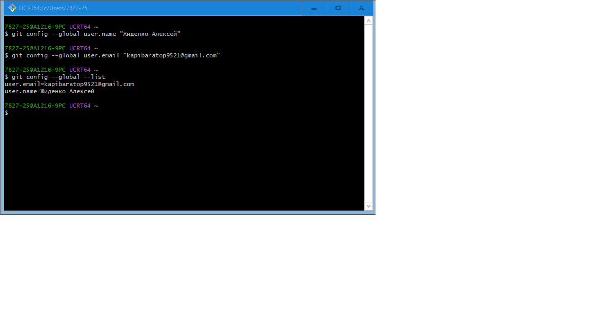
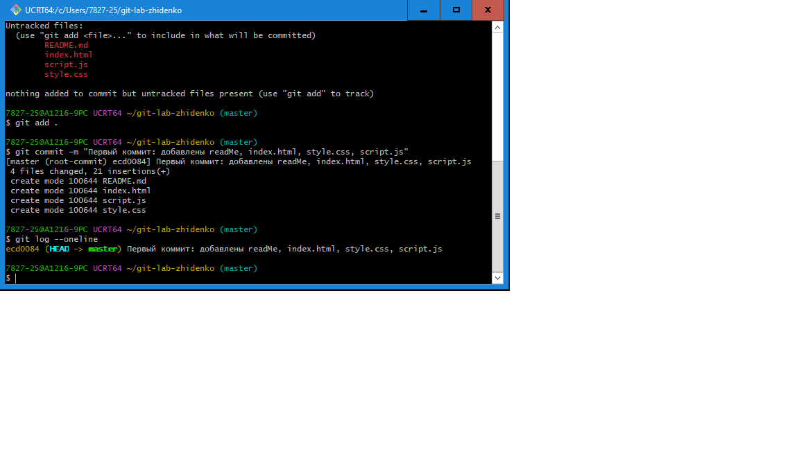
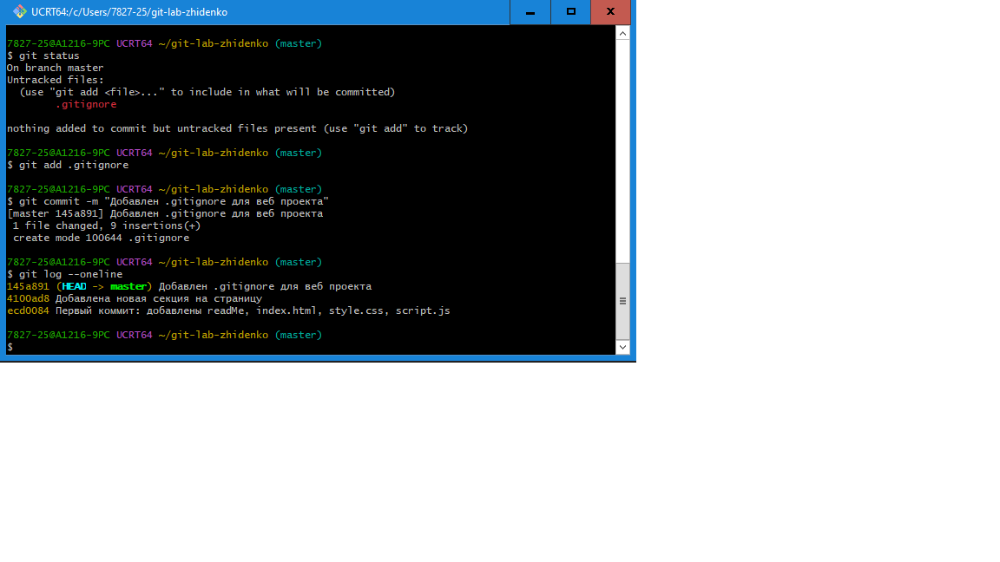
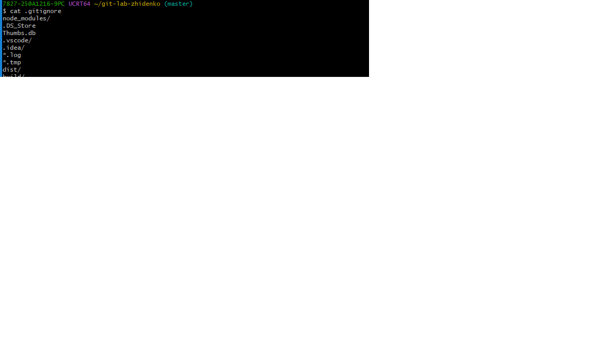
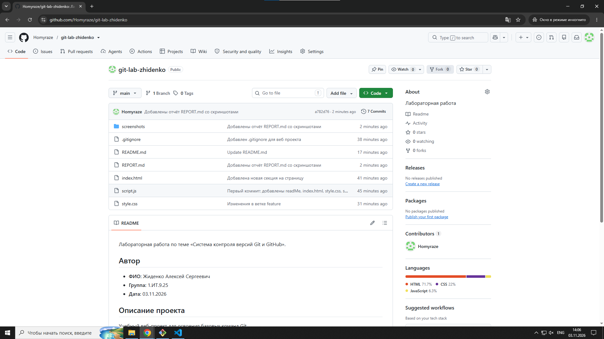
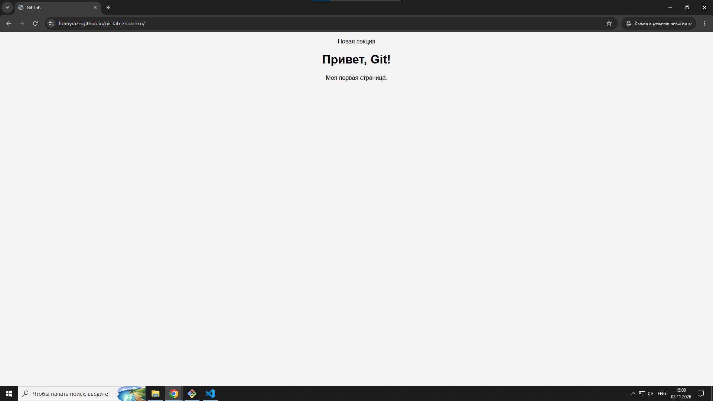

# Отчёт по лабораторной работе
## «Система контроля версий Git и GitHub»

**Выполнил:** Жиденко Алексей Сергеевич, группа 1.ИТ.9.25
**Дата:** 03.11.2026
**Ссылка на репозиторий:** https://github.com/Homyraze/git-lab-zhidenko

## Оглавление
- [1. Цель работы](#1-цель-работы)
- [2. Ход выполнения](#2-ход-выполнения)
- [3. Ответы на контрольные вопросы](#3-ответы-на-контрольные-вопросы)
- [4. Вывод](#4-вывод)

---

## 1. Цель работы
Освоить базовые команды Git и научиться публиковать веб-проекты на GitHub.

## 2. Ход выполнения

### Задание 1. Настройка Git
Выполнены команды:
```bash
git config --global user.name "Жиденко Алексей"
git config --global user.email "почта"
git config --global --list

```



### Задание 2. Создание репозитория и README
Создан репозиторий (`git init`), файлы README.md, index.html, style.css, script.js, сделан первый коммит.



### Задание 3. Изменения и .gitignore
Изменён index.html, просмотрена разница (`git diff`), создан файл .gitignore, сделано 3 коммита.





### Задание 4. Ветвление и слияние
Создана ветка feature, внесено изменение в style.css, ветка слита в master и удалена.


### Задание 5. Публикация на GitHub
Создан пустой репозиторий, выполнены `git remote add origin`, `git branch -M main`, `git push -u origin main`.


### Задание 6. Pull
README.md изменён на GitHub, выполнен `git pull`, изменения появились локально.




### Задание 7*. Дополнительно
В README добавлена ссылка на отчёт, включён GitHub Pages, поставлен тег версии v1.0.

Сайт: https://homyraze.github.io/git-lab-zhidenko/



## 3. Ответы на контрольные вопросы

1. **Чем отличается git add от git commit?**
`git add` добавляет изменения в индекс (подготавливает к коммиту), а `git commit` фиксирует проиндексированные изменения в истории.

2. **Что такое ветка и зачем она нужна?**
Ветка — независимая линия разработки. Нужна, чтобы разрабатывать новые функции, не затрагивая основной код.

3. **В чём разница между git fetch и git pull?**
`git fetch` только скачивает изменения с удалённого репозитория, не сливая их. `git pull` скачивает и сразу сливает в текущую ветку.

4. **Что делает git status и почему его стоит выполнять часто?**
Показывает состояние рабочей директории: изменённые, добавленные и неотслеживаемые файлы. Помогает понять, что попадёт в коммит, и избежать ошибок.

5. **Что произойдёт, если выполнить git push без предварительного git pull, когда на GitHub есть новые коммиты?**
Git отклонит push, потому что локальная история отстаёт от удалённой. Сначала нужно сделать `git pull`, затем `git push`.

6. **Зачем нужен файл .gitignore? Приведите примеры для веб-проекта.**
Он указывает Git, какие файлы не отслеживать: служебные, временные, зависимости. Примеры: `node_modules/`, `.DS_Store`, `Thumbs.db`, `.vscode/`, `*.log`, `dist/`, `build/`.

7. **Чем git merge отличается от git rebase (кратко)?**
`merge` объединяет ветки, создавая коммит слияния и сохраняя историю как есть. `rebase` переносит коммиты ветки поверх другой, делая историю линейной.

## Итоги

| Задание | Результат |
|---------|-----------|
| 1. Настройка Git | выполнено |
| 2. Репозиторий и README | выполнено |
| 3. Изменения и .gitignore | выполнено |
| 4. Ветки и слияние | выполнено |
| 5. Публикация на GitHub | выполнено |
| 6. Pull и отчёт | выполнено |
| 7*. Теги и README | выполнено |

## 4. Вывод
В ходе работы я освоил базовые команды Git: настройку, создание репозитория, коммиты, ветвление и слияние, работу с .gitignore. Научился публиковать проект на GitHub и синхронизировать изменения через `git pull` и `git push`.